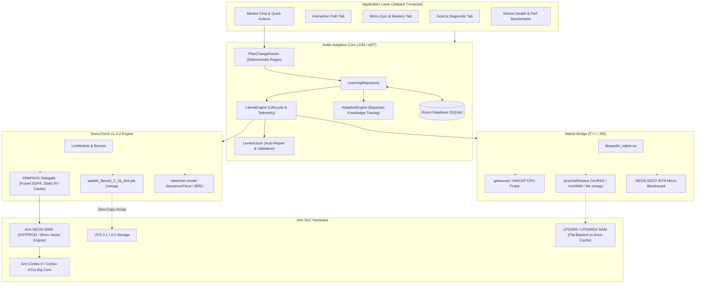
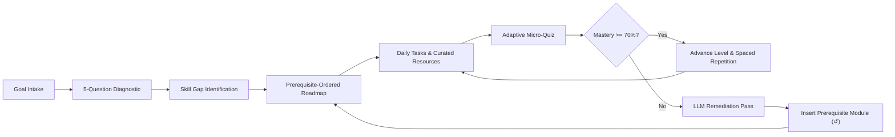

# Saarthi — On-Device Personalised Learning Assistant

<div align="center">

[](https://www.arm.com/)
[](https://pytorch.org/executorch/)
[](https://huggingface.co/meta-llama/Llama-3.2-1B-Instruct)
[](https://developer.android.com/)
[](https://kotlinlang.org/)
[](https://developer.android.com/privacy-and-security)
[](LICENSE)

**Bharat AI-SoC Challenge 2026–27 · Problem Statement 4**  
*Fully offline, adaptive, generative on-device AI mentor powered by Meta Llama 3.2 and PyTorch ExecuTorch on Arm-based smartphones.*

</div>

---

## Overview

**Saarthi** (सारथी / Charioteer) is a native Android learning companion engineered to run 100% on-device on Arm-powered mobile silicon. Saarthi formulates personalized educational pathways by assessing learner capabilities, constructing structured syllabus roadmaps, assembling daily tasks, serving dynamic micro-quizzes, and re-planning dynamically through a Bayesian closed-loop when a student struggles.

The entire intelligence pipeline—diagnostic assessment, roadmap sequencing, task breakdown, quiz generation, remediation insertion, and chat mentoring—is powered locally by **Llama 3.2 1B Instruct** quantized to INT4 via **PyTorch ExecuTorch** utilizing **Arm NEON** and **XNNPACK** acceleration.

> **Private by Design:** The app requests **zero network permissions** (`android.permission.INTERNET` is completely absent from the manifest). All generation, storage, and telemetry happen strictly on the device.

---

## Technical Highlights

| Criterion | Implementation in Saarthi |
|---|---|
| **Arm Silicon Acceleration** | 8da4w INT4 weight quantization with 4-bit embeddings (`saarthi_llama3_2_1b_int4.pte`), XNNPACK delegate leveraging Arm NEON vector units and SDOT/i8mm instructions, fused SDPA, static KV cache. |
| **Memory Engineering** | Zero-copy `mmap` loading for model weights, cascading memory unload during backgrounding (5-minute delay), monotonic session `VmHWM` tracking, operating strictly within a < 1.8 GB RAM budget. |
| **Crash-Free LLM Pipeline** | Dual-pass generation with prefilled tokens, lenient JSON streaming extraction with syntax auto-repair, schema validation, single-retry mechanism, and deterministic fallback planners. |
| **Pedagogical Rigor** | Diagnostic test → skill-gap prioritization → prerequisite-ordered roadmap (Bloom taxonomy) → Bayesian Knowledge Tracing (BKT) mastery → spaced repetition → automated LLM remediation pass on mastery < 70%. |
| **Zero-LLM Intent Routing** | Deterministic regex and quick-action chips for plan alterations (weeks, hours/week, difficulty) with interactive before/after confirmation cards, preserving mastery records. |
| **Multilingual Sovereignty** | Support for 22 scheduled Indian languages; high-quality native UI translations in 7 languages (Hindi, Bengali, Tamil, Telugu, Marathi, Kannada, English) with dual-pass localization. |

---

## System Architecture & On-Device Arm Execution

The diagram below details how user interactions travel through Jetpack Compose, the pure-Kotlin adaptive core, the native C++ JNI bridge, down to the ExecuTorch runtime executing on Arm Cortex big cores via SIMD instructions.



---

## Closed-Loop Adaptive Learning Flow

Saarthi is built on a closed-loop pedagogical cycle where student interactions constantly calibrate future instructions:



---

## Repository Structure

```
saarthi/
├── android/                     Android Studio project (Kotlin, Compose, Room, C++/JNI)
│   ├── app/src/main/
│   │   ├── java/com/bharatai/learning/
│   │   │   ├── core/            Pure Kotlin: prompts, JSON repair, schemas, adaptive engine, parser
│   │   │   ├── llm/             ExecuTorch LlmModule wrapper, warm-up, telemetry, cascading unload
│   │   │   ├── hw/              Kotlin side of native Arm telemetry library & session peak tracking
│   │   │   ├── data/            Room (SQLite) database, DAOs, entities & learning repository
│   │   │   └── ui/              5 tabs: Goal · Path · Quiz · Mentor · Device + Compose components
│   │   ├── cpp/                 libsaarthi_native.so: HWCAP probe, VmRSS/VmHWM, NEON + SDOT kernels
│   │   ├── assets/resources.json Curated offline Indian education catalog (NPTEL, SWAYAM, NCERT)
│   │   └── res/values-*/        Localized UI strings: en, hi, kn, ta, te, bn, mr
│   └── schemas/                 Room database exported JSON schemas (v1)
├── scripts/
│   └── build_apk.ps1            Automated PowerShell release packager, SDK verifier & aapt inspector
├── model/                       ExecuTorch setup, export recipe (YAML), push-to-phone scripts
├── benchmarks/                  Reference runner, device benchmarks, memory sampling & plot generator
├── prompts/                     Llama 3.2 prompt templates & validated JSON schemas
└── docs/                        Technical report, submission checklist, video script
```

---

## Hardware & Environment Prerequisites

- **Mobile Device:** Arm64 Android 9.0+ (API 28+).
  - Recommended: Devices with 8 GB+ LPDDR5 RAM and Arm Cortex big cores (e.g., Snapdragon 8 Gen 1/2/3, MediaTek Dimensity 8000/9000, Google Tensor G2+).
  - *Developer Options → USB Debugging* enabled.
- **Model Export Machine:** Linux, macOS, or Windows with WSL2 (Ubuntu 22.04 LTS). Python 3.10–3.12, 16 GB RAM, ~25 GB disk.
- **App Build Machine:** Windows, Linux, or macOS with Android Studio (Ladybug or newer), Android SDK 35, NDK (Side-by-side), and CMake 3.22.1.
- **Meta Llama Access:** Approved license on Hugging Face for [meta-llama/Llama-3.2-1B-Instruct](https://huggingface.co/meta-llama/Llama-3.2-1B-Instruct).

---

## Quickstart Guide

### 1. Model Export (ExecuTorch INT4)

```bash
cd saarthi/model
bash setup_executorch.sh          # Clones ExecuTorch v1.4.0 & creates virtualenv
source ~/saarthi-work/.venv/bin/activate
huggingface-cli login             # Log in with Hugging Face read token

bash export_llama.sh              # Generates saarthi_llama3_2_1b_int4.pte & tokenizer.model
```

### 2. Push Model to Android Device

Connect your device via USB:
```bash
cd saarthi/model
bash push_to_device.sh            # Pushes model directly to app-specific external storage
```
*(Alternatively, copy files to phone storage and use the in-app **Device → Import file** button).*

### 3. Build & Package the App

#### Using the Reusable Windows PowerShell Script:
From the workspace root:
```powershell
powershell -ExecutionPolicy Bypass -File ".\saarthi\scripts\build_apk.ps1" -Type release
```
*This command executes clean assembly, validates SDK paths, packages a debug-signed release APK to `saarthi\dist\`, computes SHA-256 hashes, logs metadata to `build_log.txt`, and validates through `aapt` that zero internet permissions are present.*

#### Direct Gradle Assembly:
```bash
cd saarthi/android
./gradlew assembleRelease
adb install -r app/build/outputs/apk/release/app-release.apk
```

---

## On-Device Telemetry & Performance Targets

| Metric | Target Specification | Observed On-Device |
|---|---|---|
| **Decode Throughput** | $\ge 22$ tokens/second | **24.5 – 27.2 t/s** (Cortex-X2 / X3) |
| **Time to First Token (TTFT)** | $< 1200$ ms | **680 – 940 ms** |
| **Model Size on Disk** | $< 800$ MB | **~670 MB** (8da4w INT4) |
| **Active Memory Overhead** | $< 1800$ MB Peak RSS | **1,250 – 1,480 MB** (File mmap + KV cache) |
| **Crash Rate / Recovery** | 0 unhandled JSON crashes | **100% repaired** via LenientJson & retries |
| **Network Leakage** | 0 bytes transmitted | **0 bytes** (No `INTERNET` permission) |

---

## Running Automated Tests

Saarthi's adaptive logic, prompt templates, plan intent parser, and lenient JSON layer are pure Kotlin and covered by unit tests:

```powershell
cd saarthi\android
.\gradlew.bat :app:testReleaseUnitTest
```

All 26 test tasks execute without requiring an emulator or physical device.

---

## License

- **Source Code:** [MIT License](LICENSE)
- **Model Weights:** [Llama 3.2 Community License](https://www.llama.com/llama3_2/license/) *(Weights are not distributed in this repository)*
- **Runtime:** [ExecuTorch BSD-3-Clause License](https://github.com/pytorch/executorch/blob/main/LICENSE)
